<p align="center">
  <picture>
    <source media="(prefers-color-scheme: dark)" srcset="constellate/constellate-dark.svg">
    
  </picture>
</p>

<h1 align="center">Constellate</h1>

<p align="center"><b>Every repository is a star.</b></p>

Every night, Constellate reads your public repositories and charts them as a night sky.

- **Each repo is a star.** It shines brighter the more you committed to it this year.
- **Each language is a constellation.** Repos in the same language are joined into a shape, with a name to match: *Serpens* for Python, *Cancer* (the crab) for Rust, *Typhon* for TypeScript, *Cetus* (the whale) for Docker…
- **Starred repos sparkle.** Any repo with a stargazer gets diffraction spikes.
- **The moon is your streak.** It's a new moon at 0 days and grows to full at 14.
- **New repos are shooting stars.** A repo created in the last 45 days streaks across the sky.
- **Recent work pulses.** Anything you pushed this week has a soft ring.

When the image loads, the stars fade in, the constellation lines draw themselves, and the sky keeps twinkling. It's one Node script with no dependencies, and it outputs two animated SVGs (light and dark). Star positions are seeded from your username, so your sky keeps its shape from night to night.

## Add it to your profile

**1. Add the workflow** to your profile repo (`<you>/<you>`) at `.github/workflows/constellate.yml`:

```yaml
name: Constellate

on:
  schedule:
    - cron: '0 0 * * *'   # every night
  workflow_dispatch:

permissions:
  contents: write

jobs:
  constellate:
    runs-on: ubuntu-latest
    steps:
      - uses: actions/checkout@v5
      - uses: AnitaGeorge404/constellate@v1
```

**2. Run it once:** go to **Actions → Constellate → Run workflow**.

**3. Show it** in your profile `README.md`:

```html
<picture>
  <source media="(prefers-color-scheme: dark)" srcset="constellate/constellate-dark.svg">
  
</picture>
```

## Options

| Input          | Default        | What it does                 |
| -------------- | -------------- | ---------------------------- |
| `github_user`  | repo owner     | Whose sky to draw            |
| `github_token` | `github.token` | Token for the GitHub API     |
| `output_dir`   | `constellate`  | Where the SVGs go            |
| `commit`       | `true`         | Commit and push the result   |

Only public, non-archived, non-fork repositories are drawn (up to 60, most recently pushed first).

## Run it locally

Needs Node 20+ and nothing to install.

```bash
node src/index.js --demo --out examples          # made-up sky
GITHUB_TOKEN=$(gh auth token) node src/index.js --user <your-login>
```

## How it works

| File            | Job |
| --------------- | --- |
| `src/github.js` | One GraphQL query: public repos, commits per repo this year, contribution calendar |
| `src/sky.js`    | Places constellations by best-candidate sampling, spreads stars inside each, joins them with a minimum spanning tree |
| `src/render.js` | Glows, spikes, moon phase, shooting star and the draw-in animation |

## License

MIT
